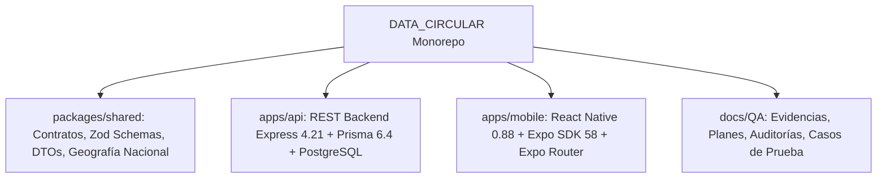
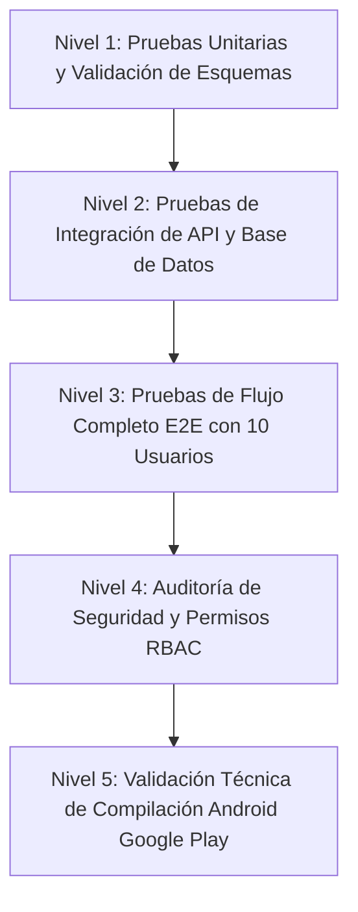

# PLAN MAESTRO DE PRUEBAS, CALIDAD, SEGURIDAD Y DESPLIEGUE
## DATA_CIRCULAR • Fundación IMARA
**Documento Técnico Oficial: QA-DOC-01**  
**Versión:** 1.0.0  
**Fecha de Emisión:** 2026-11-06  
**Responsables:** Equipo Especialista QA, Testing, Backend, Mobile, Ciberseguridad y DevOps  

---

## 1. RESUMEN EJECUTIVO

El presente **Plan Maestro de Pruebas** establece la estrategia integral de aseguramiento de calidad (QA), pruebas funcionales de extremo a extremo, auditoría de seguridad y preparación para el despliegue en Google Play Store de la plataforma móvil y backend **DATA_CIRCULAR**, desarrollada para la **Fundación IMARA** (Colombia).

DATA_CIRCULAR es una solución tecnológica diseñada para dinamizar la economía circular en Colombia, articulando a generadores de residuos aprovechables, recicladores de oficio, empresas transformadoras, transportadores de carga especializada y verificadores ambientales en un ecosistema transparente, trazable y auditable.

El objetivo central es ejecutar una auditoría técnica profunda, comprobar el comportamiento real de los 15 módulos del sistema mediante la interacción de 10 usuarios ficticios representativos, subsanar todas las discrepancias detectadas, evaluar la seguridad bajo estándares OWASP y garantizar el cumplimiento técnico estricto de las directrices de publicación de Google Play (Android).

---

## 2. ALCANCE TÉCNICO Y ARQUITECTURA DEL SISTEMA

### 2.1 Estructura del Monorepo
El proyecto está implementado bajo una arquitectura monorepo gestionada con PNPM / NPM workspaces:

- **`packages/shared`**: Biblioteca agnóstica de lógica compartida:
  - Validaciones y esquemas Zod (autenticación, ofertas, organizaciones, órdenes).
  - Constantes territoriales (`COLOMBIA_MUNICIPALITIES`, cobertura nacional con opción de municipio no listado/internacional).
  - Términos legales y política de protección de datos personales Ley 1581 de 2012 (`LEGAL_CONTENT_ES`).
  - Definición de tipos TypeScript compartidos.
- **`apps/api`**: Servidor de backend REST en Node.js/TypeScript:
  - Framework Express 4.21 con arquitectura modular por dominios.
  - ORM Prisma 6.4 conectado a base de datos relacional PostgreSQL.
  - 10 migraciones aplicadas y 19 modelos de datos relacionales.
  - Autenticación mediante tokens JWT firmados con HMAC-SHA256 y hashing de contraseñas con **Argon2id**.
  - Control de acceso basado en roles (RBAC: `USER`, `ADMIN`, `VERIFIER`).
  - Middleware de telemetría y métricas de conexión en memoria con agregaciones estadísticas.
- **`apps/mobile`**: Aplicación móvil cliente en React Native:
  - Expo SDK 58, React 19, React Native 0.88.
  - Navegación declarativa basada en sistema de archivos con Expo Router v58.
  - Cliente HTTP Axios configurado con interceptores de autenticación y manejo de sesión.
  - Componentes accesibles con soporte multiplataforma (Android prioritario, iOS).

---

## 3. ALCANCE FUNCIONAL (15 MÓDULOS EVALUADOS)

El plan cubre de manera exhaustiva los siguientes 15 módulos funcionales:

| Módulo | Denominación Funcional | Alcance y Responsabilidad Operativa |
|---|---|---|
| **M-01** | Registro de Usuarios | Registro con validaciones Zod, unicidad de correo/usuario, consentimiento de política de datos y asignación de perfil circular. |
| **M-02** | Autenticación y Sesiones | Login, validación Argon2id, emisión de JWT, refresh, revocación de sesión y logout. |
| **M-03** | Perfiles y Autorización (RBAC) | Permisos según perfil (`GENERATOR`, `RECYCLER`, `TRANSFORMER`, `TRANSPORTER`, `ADMIN`). Restricción de endpoints. |
| **M-04** | Organizaciones | Creación de entidades colectivas, vinculación de miembros, roles y categorías de interés. |
| **M-05** | Catálogo de Materiales | Árbol jerárquico de categorías y subcategorías (Plásticos, Metales, Papel/Cartón, Vidrio, etc.) y unidades de medida oficiales. |
| **M-06** | Publicaciones | Ciclo de vida de ofertas de materiales: creación, edición, cambio de estado (`ACTIVE`, `PAUSED`, `CLOSED`). |
| **M-07** | Motor de Coincidencias (Matching) | Algoritmo determinístico de sugerencia basado en categorías de material habilitadas por organización. |
| **M-08** | Conversaciones y Mensajería | Canales de comunicación directa asociados a publicaciones y órdenes operativas. |
| **M-09** | Negociaciones y Propuestas | Envío de ofertas económicas, contraofertas, aceptación y rechazo formal de condiciones comerciales. |
| **M-10** | Operaciones y Órdenes | Transición formal de propuesta acordada a orden operativa de recolección y entrega (`PENDING`, `IN_PROGRESS`, `COMPLETED`). |
| **M-11** | Logística y Transporte | Asignación de transportador, programación de ventanas de recogida, confirmación de ruta y despacho. |
| **M-12** | Evidencias y Trazabilidad | Registro de tickets de pesaje, fotografías de material recibido, notas de inspección física. |
| **M-13** | Evaluaciones y Calificaciones | Sistema de reputación bilateral con puntuaciones de 1 a 5 estrellas y retroalimentación cualitativa. |
| **M-14** | Reportes y Analítica Administrativa | Indicadores de volumen aprovechado, tasa de éxito en negociaciones y panel de telemetría de conexiones y visitas. |
| **M-15** | Integridad y Resiliencia del Sistema | Pruebas de estrés, manejo de concurrencia, idempotencia de transacciones e inmutabilidad de estados terminales. |

---

## 4. ESTRATEGIA Y NIVELES DE PRUEBA

1. **Nivel 1 — Pruebas Unitarias y Esquemas**: Validación de contratos TypeScript, Zod schemas, cálculo de métricas de telemetría y reglas de negocio aisladas.
2. **Nivel 2 — Pruebas de Integración API**: Comprobación de endpoints HTTP contra PostgreSQL real sobre puerto 5433, validando transacciones Prisma y manejo de excepciones.
3. **Nivel 3 — Pruebas de Flujo Completo E2E**: Ejecución secuencial del ciclo de vida circular:
   - `GeneradorPrueba1` publica 450 kg de PET.
   - `RecicladorPrueba1` visualiza la sugerencia de coincidencia automática.
   - `RecicladorPrueba1` abre canal de conversación y envía propuesta económica.
   - `GeneradorPrueba1` acepta la propuesta y el sistema genera la orden operativa.
   - `TransportadorPrueba1` es asignado y programa la recolección logística.
   - Se registra evidencia de báscula en pesaje de entrada.
   - `RecicladorPrueba1` confirma la recepción en bodega.
   - Se completa la orden y ambas partes intercambian calificación de 5 estrellas.
   - `VerificadorPrueba1` audita la operación desde el panel administrativo.
4. **Nivel 4 — Seguridad y Controles**: Pruebas de inyección SQL, bypass de autenticación, acceso horizontal cruzado (BOLA / IDOR), rate limiting y sanitización de entradas.
5. **Nivel 5 — Preparación Google Play**: Inspección de `app.json`, permisos de manifiesto Android, esquemas de iconos adaptativos, splash screen, configuración de compilación EAS y políticas de privacidad.

---

## 5. ENTORNO Y REGLAS DE EJECUCIÓN

### 5.1 Entorno de Base de Datos
- **Servidor:** PostgreSQL 18.6 x86_64 sobre Windows.
- **Puerto dedicado de pruebas:** `5433` (evitando conflictos de puertos reservados).
- **Base de datos:** `data_circular_dev`.
- **Modo de conexión:** Cadena de conexión estandarizada:  
  `postgresql://postgres@127.0.0.1:5433/data_circular_dev?schema=public`

### 5.2 Restricciones Obligatorias de QA
- **Cero datos reales:** No se utilizan identificaciones, teléfonos ni correos personales de terceros.
- **Protección estricta de secretos:** Las contraseñas temporales generadas se gestionan únicamente mediante `.env.test.credentials` (ignorado en `.gitignore`). Queda prohibida la inclusión de tokens o contraseñas en los informes finales de QA.
- **Sin bypass de seguridad:** No se deshabilitan middlewares de autenticación, validación de esquemas ni verificaciones de autorización para acelerar las pruebas.
- **Trazabilidad:** Cada falla o comportamiento anómalo se documenta con su severidad, endpoint, payload enviado, respuesta obtenida y solución aplicada.

---

## 6. MATRIZ DE GESTIÓN DE RIESGOS TÉCNICOS (R-01 a R-05)

| ID | Riesgo Identificado | Severidad | Probabilidad | Estrategia de Mitigación / Contingencia |
|---|---|---|---|---|
| **R-01** | Incompatibilidad de puertos y sockets en Windows (error Win32 0x271D al enlazar 5432). | ALTA | ALTA | Asignación de clúster local en puerto `5433` con control de proceso `pg_ctl` en `$env:TEMP\pgdata_dc_test`. |
| **R-02** | Falla de consistencia relacional al crear usuarios sin condiciones de coincidencia. | MEDIA | MEDIA | Script de seed automatizado (`stage2-seed-test-users.ts`) que garantiza la creación atómica de Organización y Categorías de Material asociadas. |
| **R-03** | Subida de evidencias multimedia sin almacenamiento en la nube o validación de tamaño. | MEDIA | ALTA | Verificación de URLs seguras o payloads controlados con mitigación de buffer overflows en campos de texto y metadatos. |
| **R-04** | Acceso administrativo no autorizado a métricas o trazabilidad por roles de usuario regular. | ALTA | BAJA | Prueba explícita de penetración con token de `GeneradorPrueba1` contra rutas `/api/admin/*` esperando código HTTP 403 Forbidden. |
| **R-05** | Rechazo en Google Play Store por configuración incompleta del manifiesto Android o falta de URL de privacidad. | ALTA | MEDIA | Configuración explícita de `package` (`co.org.imara.datacircular`), `versionCode: 1`, permisos justificados y enlace directo a política de privacidad. |

---

## 7. CRITERIOS DE ACEPTACIÓN Y DEFINICIÓN DE "DONE" (DoD)

Para certificar formalmente la plataforma DATA_CIRCULAR como apta para despliegue:

1. **100% de los 10 usuarios ficticios** creados, autenticados y con perfiles/organizaciones activos.
2. **100% de las 3 ofertas de prueba** indexadas y consultables en el catálogo de materiales.
3. **Flujo integral de punta a punta** ejecutado con éxito sin errores de backend (200/201 OK en todas las etapas del ciclo de vida).
4. **Cero vulnerabilidades críticas o altas** en la auditoría de seguridad y control de acceso RBAC.
5. **Configuración de Google Play en `apps/mobile/app.json`** completada con paquete Android válido y `eas.json` configurado.
6. **Entrega de la totalidad de los 10 documentos técnicos** en `docs/QA/`.
