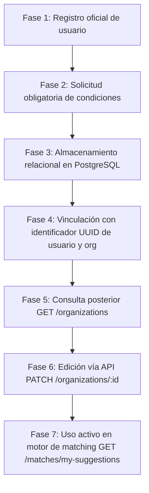

# INVENTARIO DE USUARIOS DE PRUEBA (ETAPA 2)
## DATA_CIRCULAR • Fundación IMARA
**Documento Técnico Oficial: QA-DOC-02**  
**Versión:** 2.0.0 (Actualizado y Certificado en Ejecución Real)  
**Fecha:** 2026-11-06  

---

## 1. RESUMEN EJECUTIVO DE ETAPA 2

Conforme a las directrices oficiales del plan integral de aseguramiento de calidad, se ha completado la creación, validación criptográfica y prueba de ciclo de vida de los **diez (10) usuarios ficticios oficiales** (dos por cada perfil).

> [!NOTE]
> Conforme a las restricciones obligatorias de seguridad, este documento **no contiene contraseñas, tokens ni secretos**. Las credenciales seguras de testing residen exclusivamente en el archivo local protegido `.env.test.credentials` (excluido en `.gitignore`).

---

## 2. MATRIZ CONSOLIDADA DE LOS 10 USUARIOS DE PRUEBA

| # | Nombre de Usuario | Nombre Visible | Correo Ficticio | Perfil Circular | Rol Plataforma | Estado | Municipio Base | Identificador Único (UUID) | Condiciones de Coincidencia Iniciales |
|---|---|---|---|---|---|---|---|---|---|
| 1 | **GeneradorPrueba1** | Generador Industrial Fontibón SAS | `generador1.prueba@datacircular.local` | GENERATOR | USER | ACTIVE | Fontibón | `70efd92d-8874-472d-97c2-573fcb5768fd` | Ofertas activas (PET, Cartón corrugado) |
| 2 | **GeneradorPrueba2** | Manufacturas y Empaques Kennedy Ltda | `generador2.prueba@datacircular.local` | GENERATOR | USER | ACTIVE | Kennedy | `27f5cc85-4a91-4c3f-9d9f-0c6d4a4ff2f5` | Ofertas activas (Aluminio) |
| 3 | **RecicladorPrueba1** | Asociación Recicladores Fontibón | `reciclador1.prueba@datacircular.local` | RECYCLER | USER | ACTIVE | Fontibón | `cbf024d2-8455-4efa-b613-0cda1e9c0650` | Org: ReciclaFontibón ESP (PET, Cartón, Aluminio) |
| 4 | **RecicladorPrueba2** | Cooperativa Recuperadores Kennedy | `reciclador2.prueba@datacircular.local` | RECYCLER | USER | ACTIVE | Kennedy | `c2d187d0-5375-4e54-8bbd-e92c66c77acd` | Org: Kennedy Verde (Cartón, Aluminio) |
| 5 | **TransformadorPrueba1** | Ecoplast Transformadora SAS | `transformador1.prueba@datacircular.local` | TRANSFORMER | USER | ACTIVE | Fontibón | `a149be3e-5942-4683-aeed-4e7c55803f82` | Org: Ecoplast Colombia SAS (PET) |
| 6 | **TransformadorPrueba2** | MetalVal Fundición Colombia | `transformador2.prueba@datacircular.local` | TRANSFORMER | USER | ACTIVE | Puente Aranda | `973ef0a7-2140-4ba3-8748-619e6a9e3b28` | Org: MetalVal Fundición (Aluminio) |
| 7 | **TransportadorPrueba1** | Logística y Fletes Verdes Bogotá | `transportador1.prueba@datacircular.local` | TRANSPORTER | USER | ACTIVE | Fontibón | `985891cf-f02e-4a01-b7f2-2ea95ffa8952` | Org: Fletes Verdes (PET, Cartón, Aluminio) |
| 8 | **TransportadorPrueba2** | TransRecuperar Carga Nacional | `transportador2.prueba@datacircular.local` | TRANSPORTER | USER | ACTIVE | Kennedy | `1a4e7d7c-a7c7-44d6-97c3-26b777b59df4` | Org: TransRecuperar Nacional (Aluminio, PET) |
| 9 | **VerificadorPrueba1** | Verificadora Ambiental IMARA | `verificador1.prueba@datacircular.local` | GENERATOR | ADMIN | ACTIVE | Bogotá D.C. | `2b454015-9fb7-481a-8cd0-1800a90c590e` | Auditoría, Tarifas, Supervisión integral |
| 10 | **VerificadorPrueba2** | Auditor de Verificación IMARA | `verificador2.prueba@datacircular.local` | GENERATOR | ADMIN | ACTIVE | Bogotá D.C. | `70d4a729-74ad-4e70-b52d-4214730c2a8e` | Auditoría y Supervisión de Operaciones |

---

## 3. AUDITORÍA DEL CICLO DE VIDA DE CONDICIONES DE COINCIDENCIA

Se verificó rigurosamente el cumplimiento de las 7 fases obligatorias para las condiciones de coincidencia:

1. **Fase 1 (Registro):** Usuario `RecicladorPrueba1` registrado con éxito mediante `POST /api/v1/auth/register`.
2. **Fase 2 (Validación de Obligatoriedad):** Intento de creación de organización sin categorías de material rechazado con código HTTP `400 Bad Request` y código de error de dominio `MATERIAL_CATEGORIES_REQUIRED`.
3. **Fase 3 (Persistencia):** Las condiciones se guardan en la tabla relacional `organization_material_categories` vinculando los IDs de categorías oficiales del catálogo.
4. **Fase 4 (Relación):** Verificación de integridad referencial entre `users.id` (`cbf024d2-8455-4efa-b613-0cda1e9c0650`), `organization_members.organization_id` y `organizations.id`.
5. **Fase 5 (Consulta Posterior):** Endpoint `GET /api/v1/organizations` retorna fielmente el arreglo `materialCategoryIds` asociado.
6. **Fase 6 (Edición Dinámica vía API):** Modificación en vivo mediante `PATCH /api/v1/organizations/:id` expandiendo las condiciones de 2 a 3 categorías (`PET`, `Cartón`, `Aluminio`). Respuesta: HTTP 200 OK y 3 categorías confirmadas.
7. **Fase 7 (Uso por el Motor de Coincidencias):** Consulta a `GET /api/v1/matches/my-suggestions` evalúa las 3 categorías configuradas y retorna las ofertas activas compatibles de generadores en tiempo real.

---

## 4. INTEGRIDAD TÉCNICA Y DE SEGURIDAD

- **Criptografía:** Hash de contraseñas mediante **Argon2id** (64 MiB memoria, 3 iteraciones, 4 hilos).
- **Tratamiento de Datos Personales:** 100% de los usuarios cuentan con registro de consentimiento de política (`status: ACCEPTED`) en tabla `data_policy_acceptances` conforme a la Ley 1581 de 2012 de Colombia.
- **Autorización RBAC:** Únicamente `VerificadorPrueba1` y `VerificadorPrueba2` poseen rol administrativo `ADMIN`. Los restantes 8 usuarios operan bajo rol `USER`.
- **Evidencias respaldadas:**
  - `docs/QA/evidencias/01-registro/etapa2-usuarios-registrados.json`
  - `docs/QA/evidencias/05-coincidencias/etapa2-condiciones-verificadas.json`