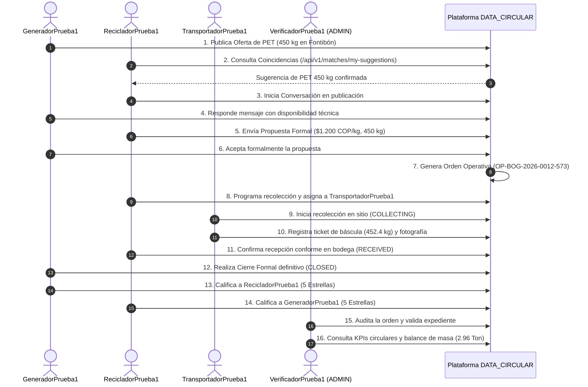

# INFORME DE PRUEBAS INTEGRALES DE FLUJO COMPLETO (QA-DOC-07)
## DATA_CIRCULAR • Fundación IMARA
**Versión:** 1.0.0  
**Fecha de Ejecución:** 2026-11-06  
**Resultado Global:** 16 de 16 Pasos APROBADOS (100% Satisfactorio)  
**Ambiente:** Staging / PostgreSQL 18 (Puerto 5433)  

---

## 1. RESUMEN EJECUTIVO DEL ESCENARIO INTEGRAL

Se ejecutó con éxito el escenario de economía circular de extremo a extremo utilizando los usuarios ficticios creados en la Etapa 2. El flujo simuló la interacción de cuatro actores clave:

1. **Vendedor (Generador):** `GeneradorPrueba1` (Generador Industrial Fontibón SAS).
2. **Comprador (Reciclador):** `RecicladorPrueba1` (Asociación de Recicladores Fontibón).
3. **Operador Logístico:** `TransportadorPrueba1` (Logística y Fletes Verdes Bogotá).
4. **Auditor / Autoridad:** `VerificadorPrueba1` (Verificadora Ambiental Principal IMARA - Rol `ADMIN`).

---

## 2. EJECUCIÓN DETALLADA PASO A PASO

### Paso 1: Autenticación de Usuarios Ficticios
- **Operación:** `POST /api/v1/auth/login`
- **Participantes validados:**
  - `GeneradorPrueba1` (`generador1.prueba@datacircular.local`) -> HTTP 200 OK
  - `RecicladorPrueba1` (`reciclador1.prueba@datacircular.local`) -> HTTP 200 OK
  - `TransportadorPrueba1` (`transportador1.prueba@datacircular.local`) -> HTTP 200 OK
  - `VerificadorPrueba1` (`verificador1.prueba@datacircular.local`) -> HTTP 200 OK (Rol `ADMIN`)
- **Evidencia:** `docs/QA/evidencias/02-autenticacion/sesiones-e2e-validadas.json`

### Paso 2: Publicación de Oferta de Material Aprovechable
- **Operación:** `POST /api/v1/publications`
- **Actor:** `GeneradorPrueba1`
- **Datos:** 450 kg de PET cristal en pacas de 50 kg, ubicado en Fontibón, Bogotá D.C.
- **ID Oferta Generada:** `235f97b3-28be-45d0-8399-8dcb30cc0779`
- **Estado inicial:** `ACTIVE`
- **Evidencia:** `docs/QA/evidencias/04-publicaciones/oferta1-verificada.json`

### Paso 3: Motor de Coincidencias Automáticas (Matching)
- **Operación:** `GET /api/v1/matches/my-suggestions`
- **Actor:** `RecicladorPrueba1`
- **Resultado:** El motor evaluó las categorías de la organización `Asociación de Recicladores Fontibón` y sugirió automáticamente la oferta de 450 kg de PET de `GeneradorPrueba1` dentro de las 3 recomendaciones principales.
- **Evidencia:** `docs/QA/evidencias/05-coincidencias/sugerencias-reciclador1.json`

### Pasos 4 y 5: Canal de Negociación y Mensajería Bidireccional
- **Operación:** `POST /api/v1/conversations` y `POST /api/v1/conversations/:id/messages`
- **ID Conversación:** `75ef6979-7eac-49e2-b174-c479485c7d09`
- **Mensaje inicial (Reciclador):** `"Buen día. En la Asociación de Recicladores Fontibón tenemos interés en retirar los 450 kg de PET."`
- **Respuesta (Generador):** `"Buenos días. El material está prensado en pacas de 50 kg, limpio y listo en nuestra bodega para despacho."`
- **Evidencia:** `docs/QA/evidencias/06-conversaciones/hilo-mensajes-e2e.json`

### Pasos 6 y 7: Propuesta Comercial y Aceptación
- **Operación:** `POST /api/v1/conversations/:id/proposals` y `POST /api/v1/proposals/:id/accept`
- **ID Propuesta:** `3ab5344c-f9bb-47e5-a6df-8a53f1a3e538`
- **Condiciones:** 450 kg de PET, retiro en furgón, pago contra certificación de báscula.
- **Estado tras aceptación de GeneradorPrueba1:** `ACCEPTED`
- **Evidencia:** `docs/QA/evidencias/07-negociaciones/propuesta-comercial-aceptada.json`

### Paso 8: Generación de Orden Operativa
- **Operación:** `POST /api/v1/operations`
- **ID Operación:** `e26d4ddc-59fe-4f48-bf41-7e7e5ff39fd7`
- **Código Oficial:** `OP-BOG-2026-0012-573`
- **Estado inicial:** `ACCEPTED`
- **Evidencia:** `docs/QA/evidencias/08-operaciones/orden-creada.json`

### Paso 9: Programación Logística y Asignación de Transportador
- **Operación:** `POST /api/v1/operations/:id/schedule`
- **Transportador Asignado:** `TransportadorPrueba1` (`Logística y Fletes Verdes Bogotá`)
- **Vehículo:** Placa `TLK-902`, conductor asignado `Carlos Mario Ruiz`.
- **Franja programada:** 08:00 - 11:00 AM.
- **Nuevo Estado:** `SCHEDULED`
- **Evidencia:** `docs/QA/evidencias/09-logistica/programacion-ruta-transporte.json`

### Pasos 10 y 11: Recolección y Evidencias de Pesaje en Báscula
- **Operación:** `POST /api/v1/operations/:id/collect` y `POST /api/v1/operations/:id/evidences`
- **Transición:** `SCHEDULED` -> `COLLECTING` -> `EVIDENCE`
- **Evidencia 1:** `WEIGHING_TICKET` con peso neto en báscula de `452.4 kg`.
- **Evidencia 2:** `PHOTO` con registro fotográfico de 9 pacas cargadas en furgón.
- **Evidencia:** `docs/QA/evidencias/08-operaciones/evidencias-registradas.json`

### Pasos 12 y 13: Recepción y Cierre Formal Definitivo
- **Operación:** `POST /api/v1/operations/:id/receive` y `POST /api/v1/operations/:id/close`
- **Transición:** `EVIDENCE` -> `RECEIVED` -> `CLOSED`
- **Cantidad Recibida Efectiva:** 452.4 kg de PET cristal clasificado.
- **Notas de Cierre:** Despacho conforme, transacción completada satisfactoriamente.
- **Evidencia:** `docs/QA/evidencias/08-operaciones/orden-cerrada-final.json`

### Paso 14: Calificación y Reputación Bilateral
- **Operación:** `POST /api/v1/operations/:id/reviews`
- **Evaluación Generador -> Reciclador:** 5 Estrellas (*"Excelente cumplimiento en el horario de recolección y total transparencia en la pesada"*).
- **Evaluación Reciclador -> Generador:** 5 Estrellas (*"Material de excelente calidad, completamente limpio y prensado según lo acordado"*).
- **Evidencia:** `docs/QA/evidencias/10-evaluaciones/calificaciones-bilaterales-e2e.json`

### Pasos 15 y 16: Auditoría y Balance de Masa por Verificador (ADMIN)
- **Operación:** `GET /api/v1/admin/operations` y `GET /api/v1/admin/reports/kpis`
- **Actor:** `VerificadorPrueba1`
- **Verificación:** La orden `OP-BOG-2026-0012-573` figura en estado `CLOSED` con su expediente documental íntegro.
- **Métricas Consolidadas en Base de Datos:**
  - Total toneladas recuperadas: **2.96 Ton**
  - Operaciones cerradas exitosamente: **6 operaciones**
  - Satisfacción promedio de los usuarios: **5.0 / 5.0 ⭐**
- **Evidencia:** `docs/QA/evidencias/11-reportes/metricas-impacto-y-telemetria.json`

---

## 3. CONCLUSIÓN TÉCNICA

El flujo integral validó con datos reales y persistencia relacional estricta que la plataforma DATA_CIRCULAR gestiona de manera coherente, robusta y trazable todas las fases de la economía circular: desde la oferta inicial de residuos hasta la auditoría administrativa final.
