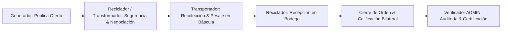
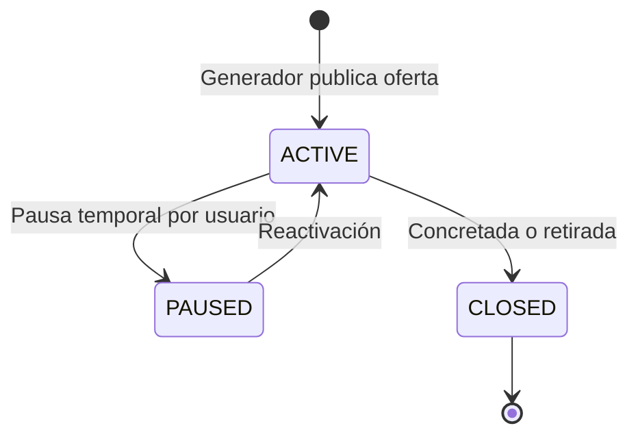
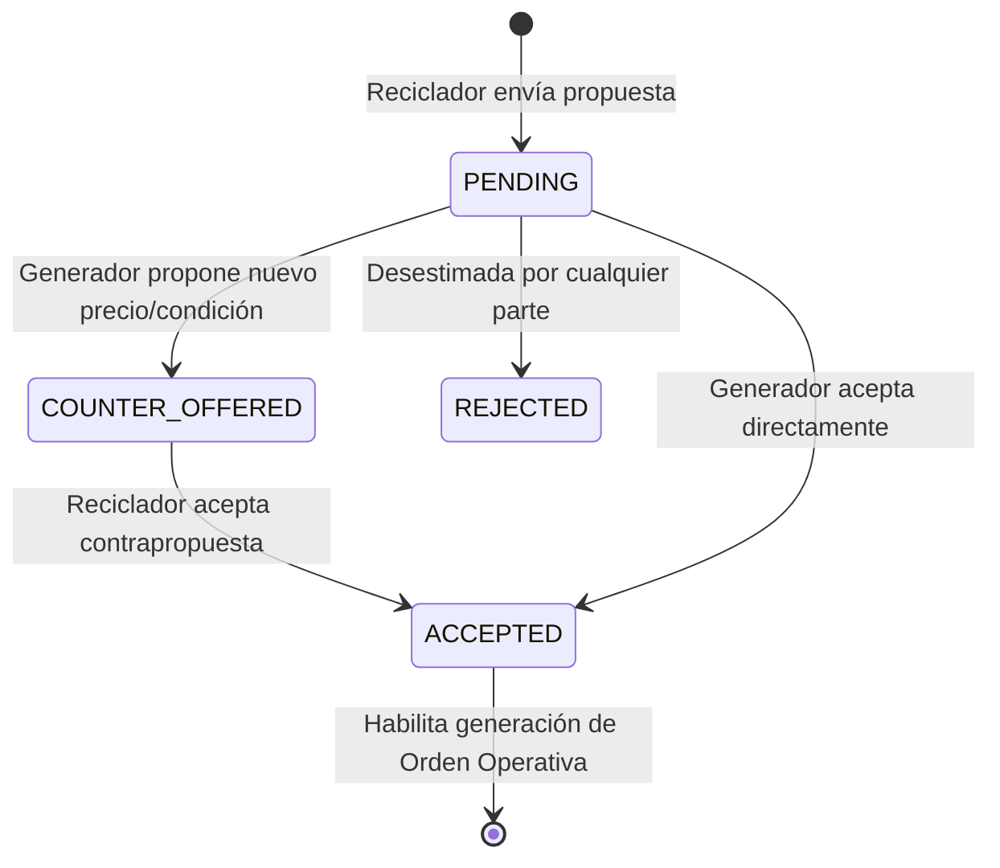
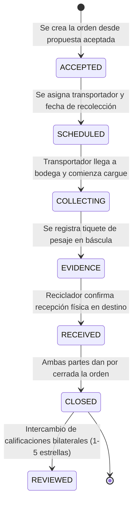

# MANUAL OPERATIVO DEL FLUJO INTEGRAL DE ECONOMÍA CIRCULAR (QA-DOC-10)
## DATA_CIRCULAR • Fundación IMARA
**Versión:** 1.0.0  
**Fecha:** 2026-11-06  
**Público Objetivo:** Usuarios de la Plataforma, Operadores Logísticos y Administradores  

---

## 1. INTRODUCCIÓN Y PROPÓSITO DEL MANUAL

Este manual describe el funcionamiento operativo integral de la plataforma **DATA_CIRCULAR**. Explica de forma didáctica y secuencial cómo interactúan los diferentes perfiles en la plataforma para transformar residuos aprovechables en materias primas secundarias con trazabilidad digital verificada.

---

## 2. MAPA DE ROLES Y RESPONSABILIDADES

1. **Generador (Comercio, Industria o Institución):**
   - Registra ofertas de materiales aprovechables (plásticos, cartón, metales, etc.).
   - Define cantidad, ubicación, estado del residuo y condiciones de entrega.
   - Evalúa y responde a las propuestas comerciales de recicladores o transformadores.
2. **Reciclador de Oficio / Asociación de Recicladores:**
   - Consulta sugerencias automáticas basadas en los materiales autorizados de su organización.
   - Inicia conversaciones directas y envía propuestas económicas formales.
   - Recibe y verifica el material en su centro de acopio o bodega.
3. **Transformador Industrial:**
   - Adquiere materiales reciclados a gran escala para reincorporarlos en ciclos productivos.
   - Participa de forma análoga al reciclador en la negociación y recepción.
4. **Transportador Especializado:**
   - Asignado a la orden operativa.
   - Planifica la ruta, coordina la ventana horaria de recolección y transporta la carga.
   - Registra el tiquete de pesaje certificado de báscula y fotografías del cargue.
5. **Verificador Ambiental (Administrador IMARA):**
   - Supervisa el cumplimiento de las operaciones.
   - Audita evidencias fotográficas y documentales de pesaje.
   - Consulta reportes de impacto circular, balance de masa distrital y telemetría de la app.

---

## 3. MÁQUINA DE ESTADOS DEL CICLO DE VIDA CIRCULAR

### 3.1 Ciclo de la Publicación de Oferta

### 3.2 Ciclo de la Propuesta Formal de Negociación

### 3.3 Ciclo de la Orden Operativa Logística

---

## 4. GUÍA OPERATIVA PASO A PASO EN LA APLICACIÓN MÓVIL

### Paso 1: Registro e Inicio de Sesión
1. Abra la aplicación **DATA_CIRCULAR**.
2. En la pantalla de registro, ingrese sus datos personales y corporativos.
3. Seleccione su perfil circular (`Generador`, `Reciclador`, `Transformador` o `Transportador`).
4. Seleccione su municipio o ciudad de Colombia dentro del catálogo alfabético nacional (o elija *"Otro"* para municipios no listados).
5. Lea y acepte la Política de Tratamiento de Datos Personales conforme a la Ley 1581 de 2012.
6. Inicie sesión con su correo electrónico y contraseña segura.

### Paso 2: Publicar una Oferta de Residuos (Solo Generadores)
1. Ingrese a la pestaña **Ofertas**.
2. Toque el botón **"Nueva Oferta"**.
3. Seleccione la categoría de material del catálogo (ej. *Plásticos > PET*).
4. Ingrese la cantidad aproximada y seleccione la unidad de medida (*kg* o *ton*).
5. Especifique la dirección exacta de recolección y la condición del material (*Limpio*, *Clasificado*, *Prensado*).
6. Presione **"Publicar Oferta"**.

### Paso 3: Buscar Materiales y Sugerencias de Coincidencia (Recicladores)
1. Ingrese a la pantalla de **Coincidencias**.
2. El sistema filtrará automáticamente las ofertas activas compatibles con las categorías configuradas por su organización.
3. Toque la oferta de interés para revisar detalles de ubicación y volumen.

### Paso 4: Chatear y Enviar Propuesta Comercial
1. En la vista de detalle de la oferta, pulse **"Contactar al Generador"**.
2. Escriba un mensaje para coordinar aspectos logísticos.
3. Pulse **"Enviar Propuesta Formal"** e ingrese el precio acordado por kilogramo y las condiciones de retiro.
4. El generador recibirá la notificación y podrá **Aceptar** o **Contraofertar**.

### Paso 5: Gestión de la Orden y Asignación de Transporte
1. Una vez aceptada la propuesta, la orden se creará con código único (ej. `OP-BOG-2026-0012-573`).
2. Se agenda la fecha y franja horaria de recogida y se asigna el transportador especializado.
3. El transportador recibe la hoja de ruta en su aplicación.

### Paso 6: Recolección, Báscula y Evidencias
1. El transportador llega a la bodega del generador y pulsa **"Iniciar Recolección"**.
2. Tras realizar el cargue y pasar por báscula, el transportador o reciclador pulsa **"Subir Evidencia"**.
3. Selecciona tipo **Ticket de Pesaje** (`WEIGHING_TICKET`), fotografía el tiquete físico e ingresa el peso neto en kilogramos.
4. Opcionalmente adjunta fotografías del material en el camión.

### Paso 7: Recepción y Cierre Formal
1. En el centro de acopio, el reciclador inspecciona el material y pulsa **"Confirmar Recepción"**.
2. El generador y reciclador proceden al **"Cierre de Operación"**.
3. El sistema habilita la pantalla de calificación bilateral, donde cada parte evalúa puntualidad, calidad del material y cumplimiento de acuerdos (1 a 5 estrellas).

### Paso 8: Supervisión y Verificación (Administradores IMARA)
1. Los verificadores ambientales ingresan con rol `ADMIN` al **Panel de Administración**.
2. Auditan la trazabilidad de la orden, los comprobantes de báscula y las bitácoras horarias.
3. Consultan el tablero de indicadores de impacto ambiental (toneladas recuperadas, balance de masa y métricas de conexiones).

---

## 5. RESOLUCIÓN DE DUDAS Y PREGUNTAS FRECUENTES (FAQ)

- **¿Puedo modificar una oferta una vez publicada?**  
  Sí, mientras permanezca en estado `ACTIVE` y no tenga una propuesta formal en negociación avanzada.
- **¿Qué ocurre si el peso en báscula difiere de la cantidad estimada en la oferta?**  
  El peso que rige la transacción final es el registrado en el ticket oficial de pesaje durante la fase de evidencias (`EVIDENCE`).
- **¿Las evidencias pueden borrarse después de cerrar la orden?**  
  No. Por exigencia de auditoría ambiental y regulatoria de la Fundación IMARA, las evidencias quedan protegidas de forma inmutable.
